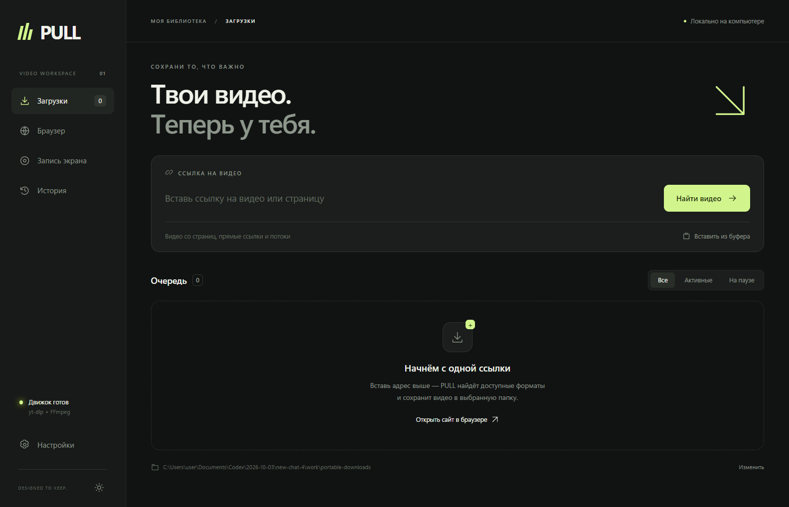

# PULL

**Сохраните видео, которое хотите оставить у себя.** PULL находит доступные форматы по ссылке, обнаруживает потоки во время просмотра в браузере и записывает окно с системным звуком.

**Windows x64 · версия 1.2.1 · обновляется из приложения**

[**Скачать PULL**](https://github.com/cveloy102/pull-video-downloader/releases/download/v1.2.1/PULL-Setup-1.2.1-Sidebar.exe) · [Расширение Edge / Chrome](https://github.com/cveloy102/pull-video-downloader/releases/download/v1.2.1/PULL-extension.zip) · [Все релизы](https://github.com/cveloy102/pull-video-downloader/releases) · [История версий](CHANGELOG.md)

## Интерфейс

## Четыре способа сохранить видео

| Способ | Когда использовать |
| --- | --- |
| По ссылке | Вставьте адрес страницы или прямой медиафайл, выберите формат и качество. |
| Во встроенном браузере | Откройте сайт и нажмите Play: PULL сам отсеет рекламу и предложит скачать главное видео. |
| Из Edge или Chrome | Передайте поток с выбранной вкладки через расширение в приложение. |
| Запись окна | Запишите воспроизведение с экрана или окна вместе с системным звуком. |

Поддерживаются HLS, DASH, прямые медиафайлы и экстракторы yt-dlp. FFmpeg объединяет видео и звук. В приложении есть очередь, ограничение параллельных загрузок, пауза, продолжение, отмена, история и выбор папки сохранения. Можно сохранить только аудио.

Если по ссылке видео не находится, PULL сам открывает страницу во встроенном браузере. Остаётся нажать Play на видео.

PULL работает в фоне: крестик сворачивает окно в трей, а загрузки продолжаются. Из меню значка в трее можно скачать ссылку из буфера обмена, приостановить или продолжить все загрузки и открыть папку. Прогресс виден на панели задач, о готовом видео приходит уведомление. Светлая, тёмная и системная темы. Новые версии PULL находит на GitHub сам: внизу окна появляется кнопка «Обновить».

## Начало работы

1. Скачайте `PULL-Setup-1.2.1-Sidebar.exe` из релиза и установите. Отдельно ставить Python, Node.js или FFmpeg не нужно. Дальше новые версии можно устанавливать из PULL.
2. Вставьте адрес в **Загрузки** и нажмите **Найти**.
3. Выберите формат и качество; результат появится в выбранной папке.
4. Если по ссылке видео не нашлось, PULL откроет страницу во встроенном **Браузере**: включите видео и нажмите **Скачать**.

Настройки и история хранятся в профиле пользователя Windows, установщик их не содержит. При удалении программы через «Приложения» Windows они удаляются.

## Подключение расширения

1. Скачайте и распакуйте `PULL-extension.zip`.
2. Откройте `edge://extensions` или `chrome://extensions`, включите режим разработчика и выберите **Загрузить распакованное**.
3. Укажите распакованную папку расширения.
4. Подключите расширение с кодом из настроек PULL и выберите вкладку с видео.
5. Запустите наблюдение по кнопке расширения, затем отдельно передайте нужный поток в приложение.

## Ограничения и данные

DRM не снимается. Универсального извлечения с любого сайта нет: доступность зависит от сайта, авторизации и поддерживаемых форматов. Вход, CAPTCHA и действия в плеере выполняет пользователь. Истёкшие ссылки нужно получить повторно.

Данные входа и подписанные ссылки потоков хранятся только в зашифрованном виде (защита Windows), открытым текстом их в истории нет. Поэтому поток можно продолжить и после перезапуска. Если ссылка устарела, нажмите «Открыть источник», включите исходное видео и подтвердите его кнопкой «Продолжить этим видео». PULL использует сохранённые фрагменты, если источник поддерживает докачку. Отмена сохраняет уже скачанные пользовательские файлы.

Запись экрана идёт в реальном времени, сохраняется в WebM и может включать звук других программ. Защищённый контент может блокировать запись.

## В версии 1.2.1

Светлый установщик с боковой панелью, индикация обновления при перезапуске и подтверждение потока при восстановлении устаревшей ссылки. [История версий](CHANGELOG.md) · [Сборка](docs/DEVELOPMENT.md) · [Сторонние компоненты](THIRD-PARTY-NOTICES.md)
